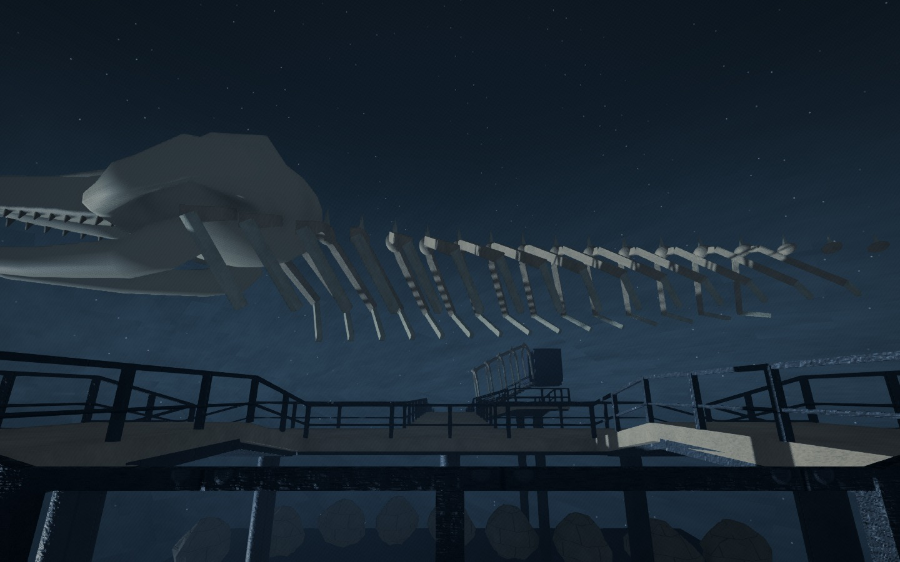

# 지하 궁륭

[English](../README.md) · [简体中文](README.zh-CN.md) · [Русский](README.ru.md) · [Español](README.es.md) · [Português (Brasil)](README.pt-BR.md) · [Deutsch](README.de.md) · [日本語](README.ja.md) · [Français](README.fr.md) · [Polski](README.pl.md) · **한국어**

끝없이 이어지는 탑을 1인칭 시점으로 걷는 게임입니다. 출발점은 도량형 기록관입니다. 서랍이 늘어선 나무다리를 건너 계단을 따라가면 조수 저수조와 천문대, 소리굽쇠 숲에 닿습니다. 탑의 주민들은 저마다 다른 소리를 냅니다. 모습이 보이기 전에 소리만 듣고도 누가 다가오는지 알 수 있습니다.


*도량형 기록관*

## 게임 실행

Linux와 Windows 버전은 모두 x86-64용이며, 게임 리소스는 실행 파일 하나에 들어 있습니다. 그래픽은 Godot의 Forward+ 렌더러를 사용합니다.

- **Windows** — `build/LowerVaults.exe`를 더블 클릭하세요.
- **Linux** — 프로젝트 디렉터리에서 다음 명령을 실행하세요.

```sh
chmod +x "build/Нижние своды.x86_64"
"./build/Нижние своды.x86_64"
```

## 조작

| 동작 | 조작 방법 |
| --- | --- |
| 탑에 들어가기 | Enter, 스페이스바 또는 **들어가기** 버튼 |
| 걷기 | WASD 또는 방향키 |
| 둘러보기 | 마우스 |
| 달리기 | 이동 중 Shift 누르고 있기 |
| 일시 정지 또는 계속하기 | Esc |
| 종료 | Esc → **게임 종료** |

일시 정지 메뉴에서 마우스 감도, 전체 음량, 내 발소리의 크기를 각각 조절할 수 있습니다.

## 언어 설정

시작 화면이나 일시 정지 메뉴 오른쪽 위에서 언어를 선택하세요. 메뉴, 조작 안내, 장소 이름이 즉시 바뀝니다. 처음 실행하면 시스템 언어를 사용하며, 지원하지 않는 언어일 경우 영어로 표시됩니다. 선택한 언어는 다음 실행 때도 유지됩니다. 이 페이지 맨 위에서 지원하는 열 가지 언어의 설명서를 열 수 있습니다.

## 스크린샷


*심연 위의 대성당*



*레비아탄의 유해*

## 소스에서 빌드하기

**Godot 4.7.1 stable**과 같은 버전의 내보내기 템플릿을 사용하세요. 템플릿은 **Editor → Manage Export Templates**에서 설치할 수 있습니다. 에디터에서 게임을 실행하려면 `project.godot`를 열고 F5를 누르세요.

두 플랫폼의 릴리스 빌드를 만들려면 프로젝트 루트에서 다음 명령을 실행하세요. `godot` 명령은 에디터 실행 파일을 가리켜야 합니다.

```sh
godot --headless --import
godot --headless --export-release "Linux"
godot --headless --export-release "Windows"
```

출력 경로는 [export_presets.cfg](../export_presets.cfg)에 지정되어 있습니다. 원문은 러시아어이며 나머지 아홉 언어의 번역은 [i18n](../i18n/)에 있습니다. 중국어, 일본어, 한국어용 대체 글꼴이 게임에 포함되어 있습니다. [글꼴 라이선스](../i18n/fonts/OFL.txt).
