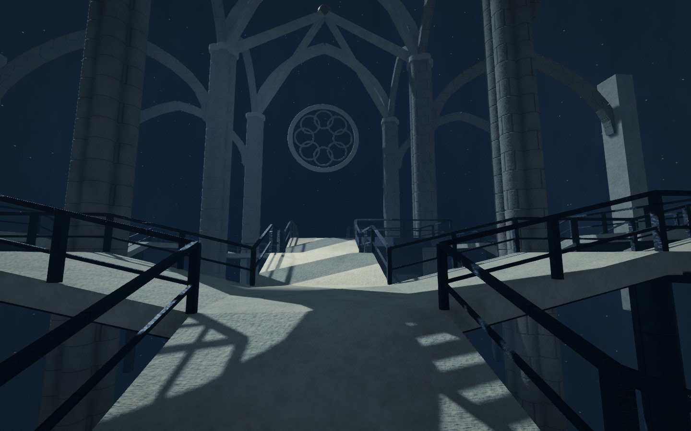

# Dolne sklepienia

[English](../README.md) · [简体中文](README.zh-CN.md) · [Русский](README.ru.md) · [Español](README.es.md) · [Português (Brasil)](README.pt-BR.md) · [Deutsch](README.de.md) · [日本語](README.ja.md) · [Français](README.fr.md) · **Polski** · [한국어](README.ko.md)

Spacer z perspektywy pierwszej osoby po wieży bez końca. Wędrówka zaczyna się w Archiwum miar i wag, na drewnianym pomoście między rzędami szuflad. Schody prowadzą do cysterny pływów, obserwatorium i lasu kamertonów. Każdy mieszkaniec wydaje charakterystyczny dźwięk, po którym można go rozpoznać, zanim pojawi się w zasięgu wzroku.


*Archiwum miar i wag*

## Uruchamianie gry

Wersje na Linux i Windows zawierają wszystkie zasoby gry w jednym pliku wykonywalnym dla architektury x86-64. Gra korzysta z renderera Forward+ silnika Godot.

- **Windows** — kliknij dwukrotnie `build/LowerVaults.exe`.
- **Linux** — wykonaj poniższe polecenia w katalogu projektu.

```sh
chmod +x "build/Нижние своды.x86_64"
"./build/Нижние своды.x86_64"
```

## Sterowanie

| Czynność | Sterowanie |
| --- | --- |
| Wejście do wieży | Enter, spacja lub przycisk **Wejdź** |
| Chodzenie | WASD lub klawisze strzałek |
| Rozglądanie się | Mysz |
| Bieg | Przytrzymaj Shift podczas ruchu |
| Pauza lub wznowienie gry | Esc |
| Wyjście | Esc → **Zakończ grę** |

W menu pauzy można ustawić czułość myszy, głośność ogólną oraz głośność własnych kroków.

## Język

Język można zmienić w prawym górnym rogu ekranu startowego lub menu pauzy. Menu, podpowiedzi i nazwy miejsc zmieniają się od razu. Przy pierwszym uruchomieniu gra wybiera język systemu, jeśli jest dostępny, a w pozostałych przypadkach angielski. Wybrany język zostaje zapisany na kolejne uruchomienie. U góry strony znajdują się odnośniki do wszystkich dziesięciu wersji językowych.

## Zrzuty ekranu



*Katedra nad przepaścią*


*Szczątki lewiatana*

## Budowanie ze źródeł

Użyj silnika **Godot 4.7.1 stable** i szablonów eksportu w tej samej wersji. Można je zainstalować z menu **Editor → Manage Export Templates**. Aby uruchomić grę w edytorze, otwórz `project.godot` i naciśnij F5.

Aby przygotować obie wersje gry, wykonaj poniższe polecenia w katalogu głównym projektu. Polecenie `godot` powinno uruchamiać edytor.

```sh
godot --headless --import
godot --headless --export-release "Linux"
godot --headless --export-release "Windows"
```

Ścieżki wyjściowe określa plik [export_presets.cfg](../export_presets.cfg). Teksty źródłowe są po rosyjsku, a dziewięć tłumaczeń znajduje się w katalogu [i18n](../i18n/). Gra zawiera czcionkę zastępczą dla języków chińskiego, japońskiego i koreańskiego. [Licencja czcionki](../i18n/fonts/OFL.txt).
