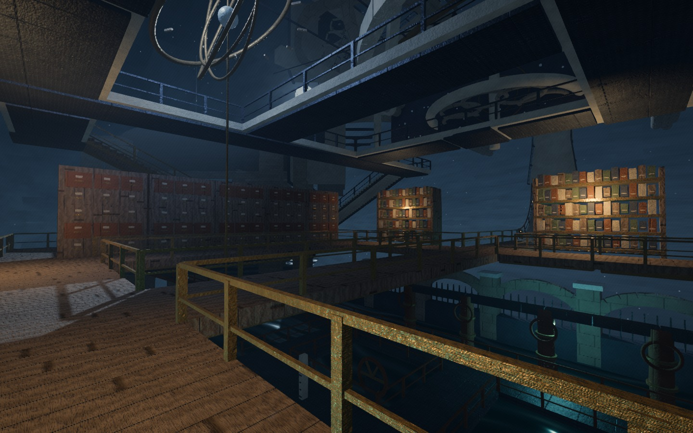

# Dolne sklepienia

[English](../README.md) · [简体中文](README.zh-CN.md) · [Русский](README.ru.md) · [Español](README.es.md) · [Português (Brasil)](README.pt-BR.md) · [Deutsch](README.de.md) · [日本語](README.ja.md) · [Français](README.fr.md) · **Polski** · [한국어](README.ko.md)

Spacer z perspektywy pierwszej osoby po wieży bez końca. Wędrówka zaczyna się w Archiwum miar i wag, na drewnianym pomoście między rzędami szuflad. Schody prowadzą do cysterny pływów, obserwatorium i lasu kamertonów. Każdy mieszkaniec wydaje charakterystyczny dźwięk, po którym można go rozpoznać, zanim pojawi się w zasięgu wzroku.



*Archiwum miar i wag*

## Uruchamianie gry

Rozpakuj całe archiwum x86-64 dla swojego systemu. Biblioteki EOS zostaw obok pliku wykonywalnego. Na początku rozgrywki skonfigurowana gra otwiera pokój i pokazuje w prawym górnym rogu jego sześcioznakowy kod, na przykład `K7Q-2MX`. Znajomi wpisują go na ekranie startowym i wybierają **Dołącz kodem**, by przejść tę samą wyprawę.

- **Windows** — kliknij dwukrotnie `build/LowerVaults.exe`.
- **Linux** — wykonaj poniższe polecenia w katalogu projektu.

```sh
chmod +x "build/Нижние своды.x86_64"
"./build/Нижние своды.x86_64"
```

## Sterowanie

| Czynność | Sterowanie |
| --- | --- |
| Wejście do wieży | Enter, spacja lub przycisk **Wejdź** |
| Chodzenie | WASD lub klawisze strzałek |
| Rozglądanie się | Mysz |
| Bieg | Przytrzymaj Shift podczas ruchu |
| Pauza lub wznowienie gry | Esc |
| Wyjście | Esc → **Zakończ grę** |

W menu pauzy można ustawić czułość myszy, głośność ogólną oraz głośność własnych kroków.

## Język

Język można zmienić w prawym górnym rogu ekranu startowego lub menu pauzy. Menu, podpowiedzi i nazwy miejsc zmieniają się od razu. Przy pierwszym uruchomieniu gra wybiera język systemu, jeśli jest dostępny, a w pozostałych przypadkach angielski. Wybrany język zostaje zapisany na kolejne uruchomienie. U góry strony znajdują się odnośniki do wszystkich dziesięciu wersji językowych.

## Zrzuty ekranu


*Katedra nad przepaścią*


*Szczątki lewiatana*

## Lista zmian

Zmiany w kolejnych wersjach opisuje [lista zmian](CHANGELOG.pl.md).

## Licencja

Kod i zasoby gry są udostępniane na [Apache License 2.0](../LICENSE). Zapasowa czcionka dla chińskiego, japońskiego i koreańskiego jest na [SIL Open Font License](../i18n/fonts/OFL.txt). Archiwa wydań zawierają też Epic Online Services SDK, który Epic rozpowszechnia na własnych warunkach.

## Code signing policy (zasady podpisywania kodu)

Free code signing provided by [SignPath.io](https://about.signpath.io/), certificate by [SignPath Foundation](https://signpath.org/). Bezpłatne podpisywanie kodu zapewnia SignPath.io, certyfikat wydaje SignPath Foundation.

- Autorzy i recenzenci: [ArcheeNic](https://github.com/ArcheeNic)
- Zatwierdzanie wydań: [ArcheeNic](https://github.com/ArcheeNic)

Podpisywane są tylko wersje dla Windows zbudowane z tego repozytorium przez [proces wydawania](../.github/workflows/release.yml). Każde wydanie jest zatwierdzane ręcznie.

## Prywatność

Gdy zaczyna się spacer, gra łączy się z Epic Online Services, by znaleźć towarzyszy po kodzie pokoju. Logowanie jest anonimowe, przez identyfikator urządzenia, a graczom w tym samym pokoju przekazywane są tylko twoja pozycja i kierunek patrzenia. Gra nie wysyła żadnych innych danych. Epic obsługuje połączenie zgodnie ze swoją [polityką prywatności](https://www.epicgames.com/site/privacypolicy).

## Zużycie tokenów podczas prac nad wersją 0.1.0

| Narzędzie | Sesje | Tokeny |
|---|---|---:|
| Codex | 4 sesje główne i 6 sesji podagentów | 75 875 836 |
| Claude Code | 1 sesja przygotowania wydania | 1 645 162 |
| **Łącznie** | **11** | **77 520 998** |

Według lokalnych dzienników z prac nad grą i wydaniem w dniach 24–25 listopada 2026 roku odczyty z pamięci podręcznej stanowiły 98,45% wszystkich tokenów. Spośród pozostałych 1 199 332 tokenów modele wygenerowały 364 313.

## Budowanie ze źródeł

Użyj silnika **Godot 4.7.1 stable** i szablonów eksportu w tej samej wersji. Można je zainstalować z menu **Editor → Manage Export Templates**. Aby uruchomić grę w edytorze, otwórz `project.godot` i naciśnij F5.

Aby przygotować obie wersje gry, wykonaj poniższe polecenia w katalogu głównym projektu. Polecenie `godot` powinno uruchamiać edytor.

```sh
python3 tools/install_eos.py
godot --headless --import
godot --headless --export-release "Linux"
godot --headless --export-release "Windows"
```

Ścieżki wyjściowe określa plik [export_presets.cfg](../export_presets.cfg). Teksty źródłowe są po rosyjsku, a dziewięć tłumaczeń znajduje się w katalogu [i18n](../i18n/). Gra zawiera czcionkę zastępczą dla języków chińskiego, japońskiego i koreańskiego. [Licencja czcionki](../i18n/fonts/OFL.txt).
